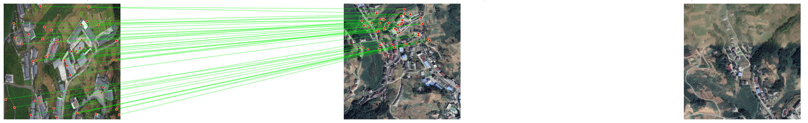
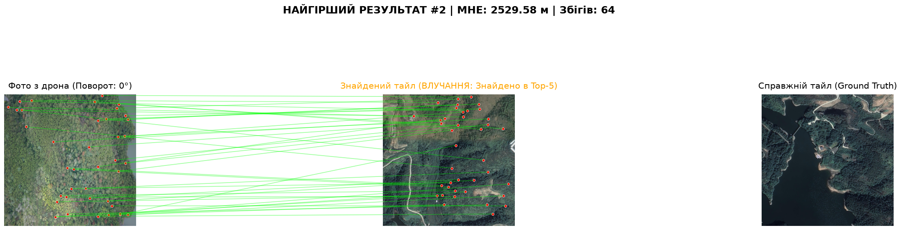
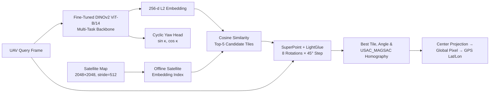

# GPS-Denied UAV Visual Geo-Localization (Coarse-to-Fine)

Two-stage cross-view visual geo-localization pipeline that estimates the geographic coordinates `(lat, lon)` of an unmanned aerial vehicle (UAV) frame against a geo-referenced satellite map **without GPS**, combining a fine-tuned multi-task **DINOv2 ViT-B/14** global retriever with rotation-aware **SuperPoint + LightGlue** keypoint matching and **USAC_MAGSAC** homography estimation.

Evaluated on the held-out **UAV-VisLoc** test sequence (Scene `06`, `344` aerial frames), the system narrows down full-map search to Top-5 candidate regions at **66.28% recall** and achieves **1.38–3.37 m** localization accuracy on structured terrain.

**Pre-Trained Checkpoints:** [GitHub Release v1.0.0 (`uav_multitask_best.pth`)](https://github.com/Rich182182/UAV-Visual-GeoLocalization/releases/tag/v1.0.0)

---

## Qualitative Localization Results

> **Panel Layout:** **Left** = Query UAV Frame (aligned to best tested yaw) | **Center** = Retrieved Top-5 Satellite Tile with **Green** LightGlue Inlier Correspondences | **Right** = Ground Truth Satellite Tile

### 1. Structured Terrain — Road & Building Intersections (`06_0301.JPG`)
**1.38 m Error** | **567 LightGlue Matches** | `0°` Yaw | Top-5 Hit



*Dense structural keypoints along roads, intersections, and building footprints lock the projective homography to within **1.38 meters** of ground truth.*

### 2. Failure Mode — Homogeneous Forest Canopy (`06_0005.JPG`)
**2529.58 m Error** | **64 Spurious Matches** | `0°` Yaw | False Canopy Lock



*On repetitive, featureless forest canopy, even when the ground-truth region enters the Top-5 retrieved candidates, `SuperPoint + LightGlue` can latch onto a visually ambiguous neighboring forest tile (`64` false correspondences), projecting the estimated position `2.53 km` away.*

---

## Executive Summary & Key Engineering Findings

- **Coarse-to-Fine Localization Performance:** Across all `344` test frames in Scene `06`, global embedding retrieval achieves **28.49% Top-1** and **66.28% Top-5** accuracy, with a **346.04 m Median Haversine Error** (`471.55 m` Mean MHE, `1333.72 m` P90). Whenever the true tile is retrieved in Top-5 over structured terrain, local geometric refinement reduces positioning error to **1.38–3.37 m**.
- **Multi-Task Orientation Supervision (`+15%` Gain):** Jointly supervising `DINOv2 ViT-B/14` to output a 256-d L2-normalized embedding (`TripletMarginLoss`) alongside continuous cyclic camera yaw $(\sin\kappa, \cos\kappa)$ (`MSELoss`) forced the backbone to learn rotation-aware spatial representations—outperforming a single-head embedding baseline by **~15%**, while avoiding the compounding errors observed when training two separate retrieval and rotation models.
- **UAV-Centered Positive Cropping & Spatial Semi-Hard Mining:** Cropping `2048×2048` positive satellite tiles centered directly on each frame's ground-truth GPS coordinates (rather than snapping to a static grid) kept key landmarks centered during training. Pairing each positive with a radially displaced negative (`2048–6144 px` offset within the same map) outperformed in-batch `InfoNCE` loss under a `batch_size=32` GPU VRAM constraint, while stitching Scene `09` from four sub-maps recovered **700+ additional training triplets**.
- **8-Direction `SuperPoint + LightGlue` vs. `LoFTR` (`+20–25%` Gain):** Dense `LoFTR` lacked rotational invariance and was computationally restricted to 4 cardinal checks (`90°` step). Replacing it with `SuperPoint + LightGlue` enabled fast **8-orientation matching (`45°` step)** across all Top-5 candidates, boosting localization accuracy by **20–25%**.
- **Sliding-Window Overlap Trade-off (`stride=512`):** Slicing `satellite06.tif` into `2048×2048` candidate tiles with `stride=512` increased Top-1/Top-5 retrieval recall by **+10–15%** by preventing true coordinates from being clipped at tile borders. Further reducing stride yielded negligible Top-1 gains (`+1–3%`) while degrading Top-5 recall (`-5–20%`) due to near-duplicate tiles saturating the top candidates.

---

## Tech Stack & Pipeline Architecture

- **Deep Learning & Metric Learning:** PyTorch, `DINOv2 ViT-B/14` (`torch.hub`), Mixed Precision (`torch.amp`), `AdamW` + `CosineAnnealingLR`
- **Local Feature Matching & Geometry:** `SuperPoint` (`4096` keypoints), `LightGlue`, OpenCV (`cv2.findHomography` with `USAC_MAGSAC`, affine rotation warping)
- **Geospatial & Data Processing:** NumPy, Pandas, Pillow (`PIL`), Haversine geodesic distance evaluation, `gdown` automated dataset distribution



---

## Quantitative Benchmarks & Error Analysis

All experiments were trained on `UAV-VisLoc` scenes `01–11` (excluding `06`, with Scene `09` stitched into a single composite map) and evaluated on all **344 frames** of held-out Scene `06`.

### 1. Overall Sequence Metrics (Scene `06`, 344 Frames)

| Metric | Value | Operational Interpretation |
| :--- | :---: | :--- |
| **Top-1 Retrieval Accuracy** | **28.49%** | Exact ground-truth coordinate falls inside the #1 ranked satellite tile |
| **Top-5 Retrieval Accuracy** | **66.28%** | True region is captured within the Top-5 candidates passed to Stage 2 |
| **Median Haversine Error (MHE)** | **346.04 m** | Median geodesic error across the full test sequence |
| **Mean Haversine Error (MHE)** | **471.55 m** | Skewed by multi-kilometer outliers on textureless forest sections |
| **P90 Haversine Error** | **1333.72 m** | 90th percentile error bound across all 344 test queries |
| **Structured-Terrain Precision** | **1.38–3.37 m** | Sub-4-meter accuracy when `132–575` LightGlue inliers are established |

### 2. Frame-Level Breakdown (Best vs. Failure Regimes)

| Regime | Frame | Ground Truth `(Lat, Lon)` | Predicted `(Lat, Lon)` | LightGlue Matches | Error (m) | Diagnostic Notes |
| :--- | :---: | :---: | :---: | :---: | :---: | :--- |
| **Best #1** | `06_0301.JPG` | `32.367881, 109.642968` | `32.367870, 109.642975` | `567` | **1.38 m** | Dense road & building network (`0°` yaw) |
| **Best #2** | `06_0332.JPG` | `32.358296, 109.644458` | `32.358310, 109.644439` | `325` | **2.36 m** | `180°` UAV rotation; recovered from **Top-5** retrieval |
| **Best #3** | `06_0060.JPG` | `32.364787, 109.638740` | `32.364770, 109.638764` | `132` | **2.93 m** | Distinct field/forest boundary geometry |
| **Best #4** | `06_0029.JPG` | `32.359820, 109.642189` | `32.359849, 109.642193` | `236` | **3.23 m** | Rural road intersection alignment |
| **Best #5** | `06_0198.JPG` | `32.359837, 109.649225` | `32.359836, 109.649189` | `575` | **3.37 m** | High-density structural keypoint lock |
| **Worst #5** | `06_0079.JPG` | `32.354909, 109.642098` | `32.370355, 109.650510` | `48` | **1890.52 m** | Uniform forest; missed by Top-5 retrieval |
| **Worst #4** | `06_0001.JPG` | `32.351541, 109.646761` | `32.369371, 109.648851` | `54` | **1992.37 m** | Featureless terrain; false global candidate |
| **Worst #3** | `06_0100.JPG` | `32.351277, 109.655699` | `32.368791, 109.640662` | `42` | **2405.76 m** | Repetitive vegetation texture mismatch |
| **Worst #2** | `06_0005.JPG` | `32.349461, 109.647460` | `32.372168, 109.649088` | `64` | **2529.58 m** | True tile in Top-5, but wrong canopy tile won match count |
| **Worst #1** | `06_0097.JPG` | `32.339193, 109.661406` | `32.359228, 109.643048` | `24` | **2817.21 m** | Dense canopy; global retrieval outside Top-5 |

---

## Ablation Studies & Design Iterations

1. **Multi-Task vs. Single-Head vs. Dual-Model Design:**
   - Freezing early `DINOv2 ViT-B/14` layers and fine-tuning only `blocks[-2:]` + `norm` (`lr=1e-5` backbone, `lr=1e-4` heads) preserved general visual representations while adapting to nadir-to-oblique aerial views.
   - Training with only the 256-d embedding head degraded overall localization metrics by **~15%** compared to the multi-task model.
   - Splitting retrieval and yaw estimation into two separate networks performed worst: the standalone rotation regressor failed to generalize across unseen terrain, and noisy yaw estimates degraded downstream matching.
2. **UAV-Centered Positive Cropping & Spatial Semi-Hard Triplets vs. InfoNCE:**
   - Cropping positive training tiles centered directly on each UAV frame's GPS coordinates (rather than matching against pre-sliced grid tiles) kept salient landmarks centered during representation learning.
   - Pairing each positive with a hard negative displaced by `2048–6144 px` on the same map outperformed `InfoNCE` loss, which suffered from insufficient negative diversity at the hardware-constrained `batch_size=32`.
3. **8-Angle `SuperPoint + LightGlue` vs. `LoFTR` & Hybrid Fallback:**
   - Initial experiments with dense `LoFTR` (4 rotations at `90°` steps) underperformed under arbitrary drone headings due to weak rotational invariance and slow inference.
   - A hybrid fallback pipeline (invoking `LoFTR` when `LightGlue` returned low match counts) slightly degraded accuracy due to false-positive dense matches on vegetation.
   - Pure `SuperPoint` (`4096` keypoints) + `LightGlue` across **8 orientations (`45°` step)** delivered a **+20–25%** accuracy boost over `LoFTR` while keeping runtime practical (~20–40 min for full sequence evaluation).

---

## Honest Limitations & Failure Modes

- **Global Retrieval Bottleneck on Textureless Terrain:** Stage 2 geometric refinement only evaluates the Top-5 tiles returned by Stage 1. When a UAV flies over large, homogeneous forest canopies or open water (`~33.7%` of Scene `06`), global embeddings lack distinctive landmarks, resulting in multi-kilometer errors (`1.8–2.8 km`) that heavily skew mean and P90 metrics.
- **Ambiguous Keypoint Matches in Repetitive Canopy:** Even when the true tile enters Top-5 (e.g., `06_0005.JPG`), repetitive tree-crown textures can yield `40–65` false keypoint correspondences on an adjacent forest tile, outscoring the true tile.
- **Compute vs. Search Budget Trade-off:** Expanding Stage 2 search from Top-5 to Top-10 candidates or increasing angular resolution from 8 (`45°`) to 12+ (`30°`) directions improves recall on edge cases, but scales local matching latency linearly. Future improvements include larger-batch `InfoNCE` training on multi-GPU setups and direct sub-tile offset regression.

---

## Repository Structure

```text
UAV-Visual-GeoLocalization/
├── src/
│   ├── dataset.py             # PyTorch Dataset for (anchor, positive, negative, sin/cos yaw)
│   ├── model.py               # Multi-task DINOv2 ViT-B/14 embedder & cyclic yaw head
│   ├── train.py               # Dataset download, semi-hard triplet mining & training loop
│   └── evaluate.py            # Overlapping tiling, embedding index, 8-angle SuperPoint+LightGlue & MHE metrics
├── notebooks/
│   └── uav_visloc_demo.ipynb  # End-to-end Google Colab & local inference walkthrough
├── assets/
├── requirements.txt           # Project dependencies
└── .gitignore                 # Excludes datasets, satellite .tif imagery, and .pth checkpoints
```

---

## Reproducibility & Quickstart

### 1. Environment Setup

```bash
git clone [https://github.com/Rich182182/UAV-Visual-GeoLocalization.git](https://github.com/Rich182182/UAV-Visual-GeoLocalization.git)
cd UAV-Visual-GeoLocalization
python -m venv .venv
.venv\Scripts\activate
pip install -r requirements.txt
```

### 2. Pre-Trained Weights

Download `uav_multitask_best.pth` from **[GitHub Release v1.0.0](https://github.com/Rich182182/UAV-Visual-GeoLocalization/releases/tag/v1.0.0)** and place it into `weights/uav_multitask_best.pth` *(if omitted, `evaluate.py` will automatically fetch the checkpoint and dataset via `gdown` on first run)*.

### 3. Run Evaluation & Metric Generation

```bash
# Builds tile index, runs coarse-to-fine localization on Scene 06, and saves metrics
python src/evaluate.py --save-plots
```

### 4. (Optional) Retrain Multi-Task DINOv2 Embedder

```bash
python src/train.py --epochs 30 --batch-size 32
```

---

## Dataset & Acknowledgments

- **Benchmark Dataset:** All experiments use the publicly available **[UAV-VisLoc](https://github.com/IntelliSensing/UAV-VisLoc)** cross-view aerial-satellite geo-localization dataset.
- **Pretrained Backbones & Matchers:** Built upon Meta AI's **[DINOv2](https://github.com/facebookresearch/dinov2)** and CVG's **[LightGlue / SuperPoint](https://github.com/cvg/LightGlue)**.
